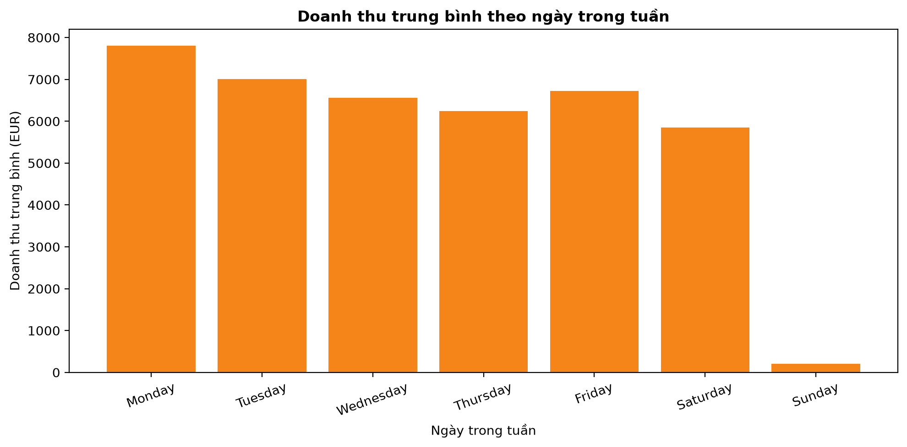
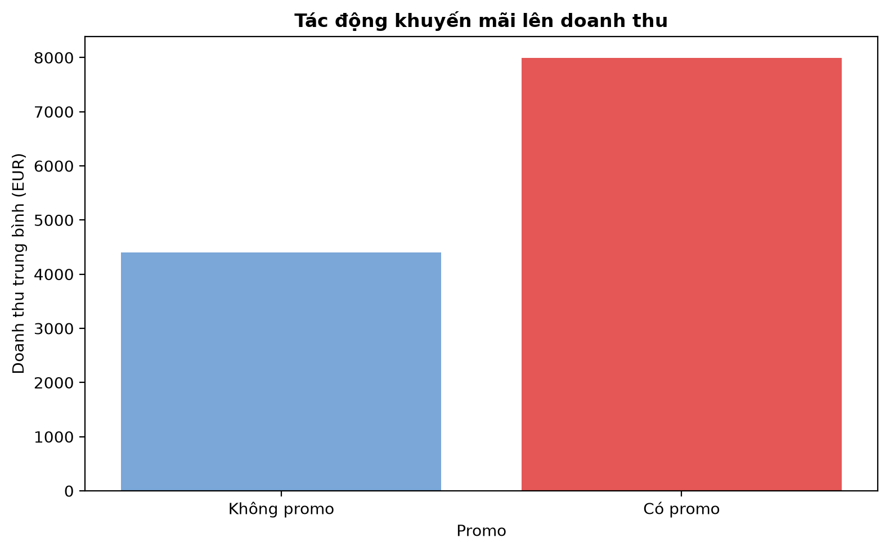
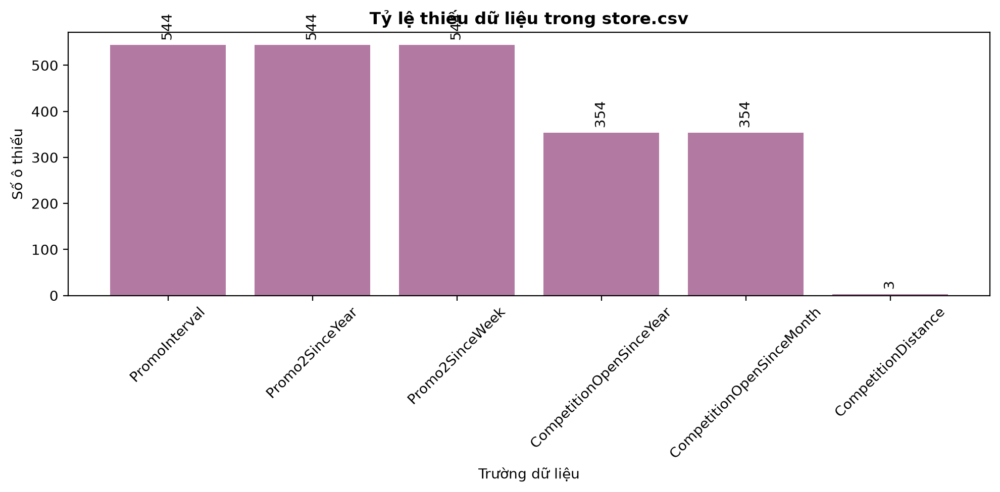
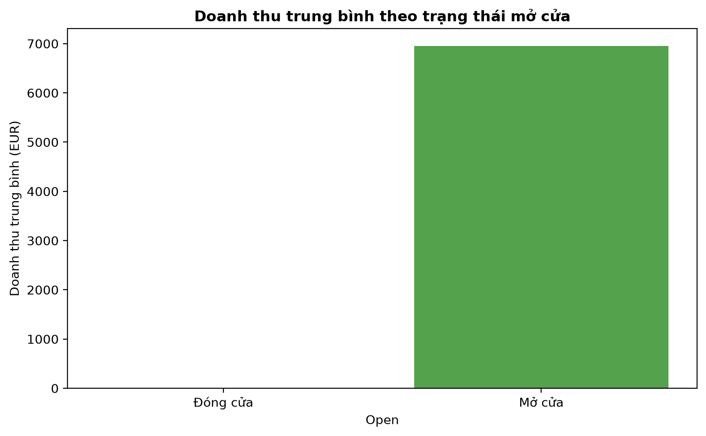
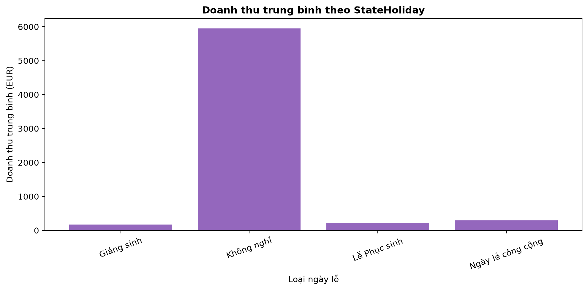
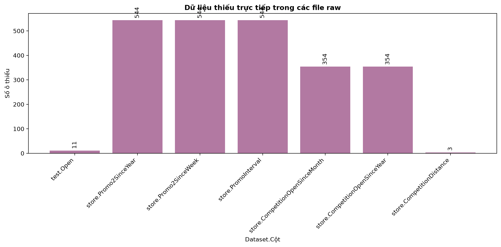

# Rossmann Sales EDA Report

## 1. Executive Summary

- EDA được chạy trực tiếp trên dữ liệu raw: train **1,017,209** bản ghi từ **2013-01-01** đến **2015-07-31**, test **41,088** bản ghi và store **1,115** cửa hàng.
- Tổng doanh thu trong train đạt **5,873,180,623 EUR**, với doanh thu trung bình khi cửa hàng mở là **6,955.51 EUR/ngày**.
- Tỷ lệ cửa hàng mở thực tế là **83.0%**.
- Khuyến mãi tạo ra hiệu ứng doanh thu rõ rệt, khoảng **3,585 EUR/ngày** chênh lệch trung bình giữa ngày có và không có promo.
- Kiểm tra khóa: train có **0** dòng tham gia trùng `(Store, Date)`; test có **0** dòng có `Id` trùng.

## 2. Dataset Overview

- Train: **1,017,209** hàng, **1,115** cửa hàng. Test: **41,088** hàng, **856** cửa hàng.
- Test bao phủ từ **2015-08-01** đến **2015-09-17**.
- Test raw có **11** giá trị `Open` thiếu; train raw không thay đổi.
- Không có bước điền thiếu, chuyển đổi hoặc merge được áp dụng trong script EDA raw.
- Chi tiết các ô thiếu theo từng file raw được tổng hợp trong mục 5.

## 3. Visual Insights

### 3.1. Xu hướng doanh thu theo tháng

### 3.2. Doanh thu trung bình theo ngày trong tuần

### 3.3. Tác động khuyến mãi

### 3.4. Top cửa hàng theo doanh thu

### 3.5. Dữ liệu thiếu trong store.csv

### 3.6. Ảnh hưởng của trạng thái mở cửa

### 3.7. Ảnh hưởng của StateHoliday

### 3.8. Dữ liệu thiếu trực tiếp trên các file raw

## 4. Business Findings

- Doanh thu có tính chu kỳ rõ ràng theo ngày trong tuần.
- **Promo** là biến có tác động lớn tới doanh thu và nên được giữ trong mô hình dưới dạng đặc trưng quan trọng.
- Các dòng `Open=0` tạo doanh thu bằng 0 và phải được xử lý khác biệt, không chỉ lấy trung bình toàn bộ train.
- Giá trị thiếu trong `store.csv` phản ánh không áp dụng hoặc thông tin chưa biết; không nên mặc nhiên coi là số không.

## 5. Summary Tables

### 5.1. Doanh thu theo ngày trong tuần

| Weekday   |   Avg_Sales |
|:----------|------------:|
| Monday    |     7809.04 |
| Tuesday   |     7005.24 |
| Wednesday |     6555.88 |
| Thursday  |     6247.58 |
| Friday    |     6723.27 |
| Saturday  |     5847.56 |
| Sunday    |      204.18 |

### 5.2. Tác động khuyến mãi

|   Promo |   Avg_Sales |   Median_Sales |   Rows |
|--------:|------------:|---------------:|-------:|
|       0 |     4406.05 |           4622 | 629129 |
|       1 |     7991.15 |           7553 | 388080 |

### 5.3. Top 5 cửa hàng theo tổng doanh thu

|   StoreID |   Total_Sales |
|----------:|--------------:|
|       262 |      19516842 |
|       817 |      17057867 |
|       562 |      16927322 |
|      1114 |      16202585 |
|       251 |      14896870 |

### 5.4. Dữ liệu thiếu trong store.csv

| Field                     |   MissingRows |
|:--------------------------|--------------:|
| PromoInterval             |           544 |
| Promo2SinceYear           |           544 |
| Promo2SinceWeek           |           544 |
| CompetitionOpenSinceYear  |           354 |
| CompetitionOpenSinceMonth |           354 |
| CompetitionDistance       |             3 |

### 5.5. Trạng thái mở cửa

|   Open |   Avg_Sales |   Median_Sales |   Rows |
|-------:|------------:|---------------:|-------:|
|      0 |        0    |              0 | 172817 |
|      1 |     6955.51 |           6369 | 844392 |

### 5.6. StateHoliday

| StateHoliday      |   Avg_Sales |   Median_Sales |   Rows |
|:------------------|------------:|---------------:|-------:|
| Giáng sinh        |      168.73 |              0 |   4100 |
| Không nghỉ        |     5947.48 |           5849 | 986159 |
| Lễ Phục sinh      |      214.31 |              0 |   6690 |
| Ngày lễ công cộng |      290.74 |              0 |  20260 |

### 5.7. Tất cả dữ liệu thiếu trong raw

| Dataset   | Field                     |   MissingRows |   MissingRate |
|:----------|:--------------------------|--------------:|--------------:|
| store     | Promo2SinceWeek           |           544 |        48.789 |
| store     | Promo2SinceYear           |           544 |        48.789 |
| store     | PromoInterval             |           544 |        48.789 |
| store     | CompetitionOpenSinceMonth |           354 |        31.749 |
| store     | CompetitionOpenSinceYear  |           354 |        31.749 |
| test      | Open                      |            11 |         0.027 |
| store     | CompetitionDistance       |             3 |         0.269 |

## 6. Recommended Next Steps

1. Xây dựng feature engineering cho biến `Promo`, `DayOfWeek`, `Month`, `StoreType`, và `CompetitionDistance`.
2. Sử dụng validation theo thời gian để tránh leakage và đánh giá mô hình chính xác hơn.
3. Tiếp tục xử lý dữ liệu thiếu ở các trường `Promo2*` và `CompetitionOpenSince*` trước khi huấn luyện.
4. So sánh baseline thống kê với LightGBM để xác định mức tăng trưởng doanh số thực tế.

## 7. Final Takeaway

Bộ dữ liệu Rossmann cho thấy mô hình dự đoán doanh thu nên tập trung vào xu hướng theo thời gian, hiệu ứng khuyến mãi và đặc điểm của từng cửa hàng. Đây là nền tảng phù hợp cho hệ thống dự báo kinh doanh và dashboard quản lý bán lẻ.
