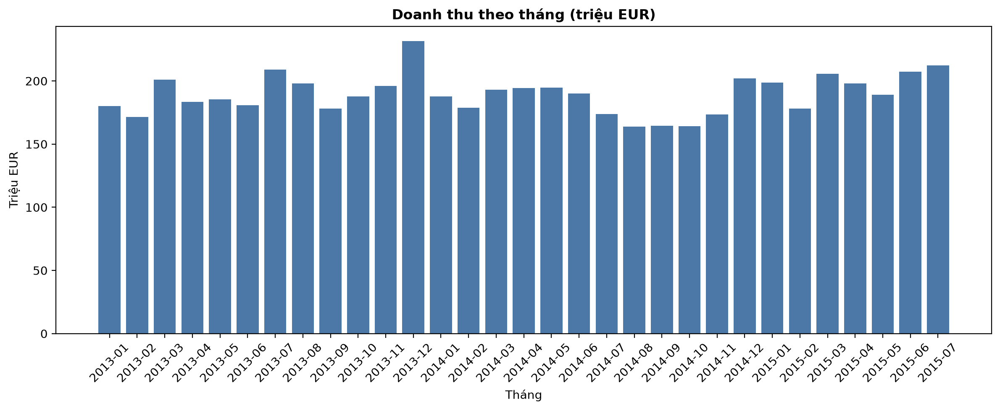
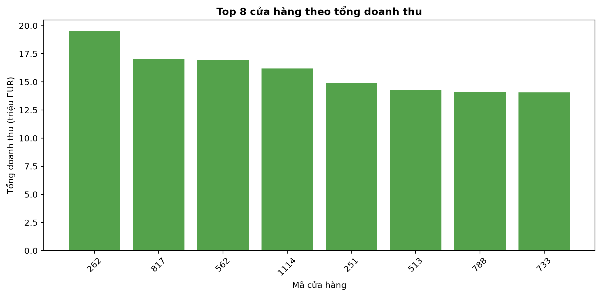

# Rossmann Sales EDA Report

## 1. Executive Summary

- Dữ liệu train bao gồm **1,017,209** bản ghi từ **2013-01-01** đến **2015-07-31** và phản ánh mô hình kinh doanh bán lẻ theo cửa hàng/ngày.
- Tổng doanh thu trong train đạt **5,873,180,623 EUR**, với doanh thu trung bình khi cửa hàng mở là **6,955.51 EUR/ngày**.
- Tỷ lệ cửa hàng mở thực tế là **83.0%**, cho thấy dữ liệu tương đối ổn định và hấp dẫn cho mô hình chuỗi thời gian.
- Khuyến mãi tạo ra hiệu ứng doanh thu rõ rệt, khoảng **3,585 EUR/ngày** chênh lệch trung bình giữa ngày có và không có promo.

## 2. Dataset Overview

- Train: **1,017,209** hàng; Test: **41,088** hàng; Store: **1,115** cửa hàng.
- Test bao phủ từ **2015-08-01** đến **2015-09-17** với **856** cửa hàng được quan sát.
- Khuyết thiếu dữ liệu cần xử lý ở `CompetitionOpenSinceMonth`, `CompetitionOpenSinceYear`, `Promo2SinceWeek`, `Promo2SinceYear`, `PromoInterval` và `CompetitionDistance`.

## 3. Visual Insights

### 3.1. Xu hướng doanh thu theo tháng

### 3.2. Doanh thu trung bình theo ngày trong tuần

### 3.3. Tác động khuyến mãi

### 3.4. Top cửa hàng theo doanh thu

### 3.5. Dữ liệu thiếu trong store.csv

## 4. Business Findings

- **Thứ Hai** và **Thứ Ba** có mức doanh thu cao hơn các ngày còn lại, cho thấy lịch bán hàng có tính chu kỳ rõ ràng.
- **Promo** là biến có tác động lớn tới doanh thu và nên được giữ trong mô hình dưới dạng đặc trưng quan trọng.
- Một số trường liên quan đến thời gian tham gia của đối thủ cạnh tranh và lịch promo 2 không có đủ dữ liệu, cần xử lý bằng cách điền trung vị hoặc tạo cờ `missing`.
- Trung bình doanh thu trong giai đoạn cuối năm có xu hướng tăng mạnh, phù hợp với chiến lược ra quyết định theo mùa.

## 5. Summary Tables

### 5.1. Doanh thu theo ngày trong tuần

| Weekday   |   Avg_Sales |
|:----------|------------:|
| Monday    |     7809.04 |
| Tuesday   |     7005.24 |
| Wednesday |     6555.88 |
| Thursday  |     6247.58 |
| Friday    |     6723.27 |
| Saturday  |     5847.56 |
| Sunday    |      204.18 |

### 5.2. Tác động khuyến mãi

|   Promo |   Avg_Sales |   Median_Sales |   Rows |
|--------:|------------:|---------------:|-------:|
|       0 |     4406.05 |           4622 | 629129 |
|       1 |     7991.15 |           7553 | 388080 |

### 5.3. Top 5 cửa hàng theo tổng doanh thu

|   StoreID |   Total_Sales |
|----------:|--------------:|
|       262 |      19516842 |
|       817 |      17057867 |
|       562 |      16927322 |
|      1114 |      16202585 |
|       251 |      14896870 |

### 5.4. Dữ liệu thiếu trong store.csv

| Field                     |   MissingRows |
|:--------------------------|--------------:|
| PromoInterval             |           544 |
| Promo2SinceYear           |           544 |
| Promo2SinceWeek           |           544 |
| CompetitionOpenSinceYear  |           354 |
| CompetitionOpenSinceMonth |           354 |
| CompetitionDistance       |             3 |

## 6. Recommended Next Steps

1. Xây dựng feature engineering cho biến `Promo`, `DayOfWeek`, `Month`, `StoreType`, và `CompetitionDistance`.
2. Sử dụng validation theo thời gian để tránh leakage và đánh giá mô hình chính xác hơn.
3. Tiếp tục xử lý dữ liệu thiếu ở các trường `Promo2*` và `CompetitionOpenSince*` trước khi huấn luyện.
4. So sánh baseline thống kê với LightGBM để xác định mức tăng trưởng doanh số thực tế.

## 7. Final Takeaway

Bộ dữ liệu Rossmann cho thấy mô hình dự đoán doanh thu nên tập trung vào xu hướng theo thời gian, hiệu ứng khuyến mãi và đặc điểm của từng cửa hàng. Đây là nền tảng phù hợp cho hệ thống dự báo kinh doanh và dashboard quản lý bán lẻ.
